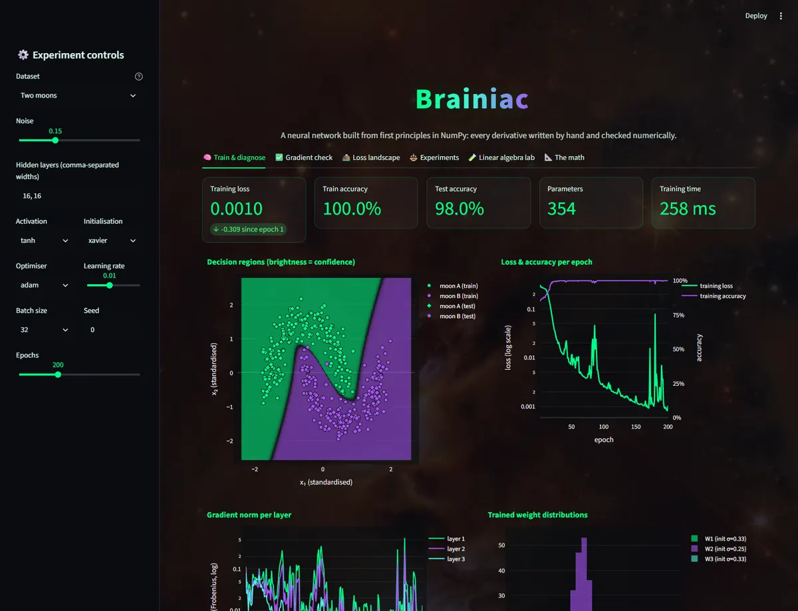
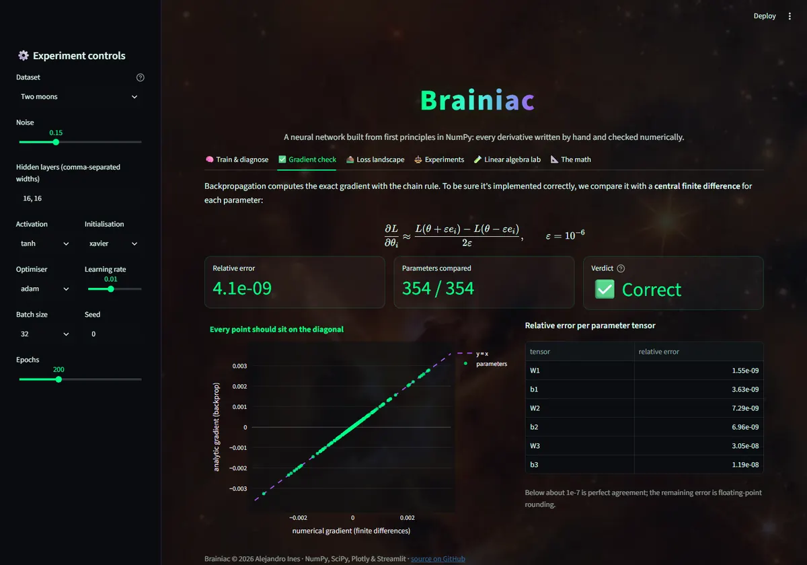
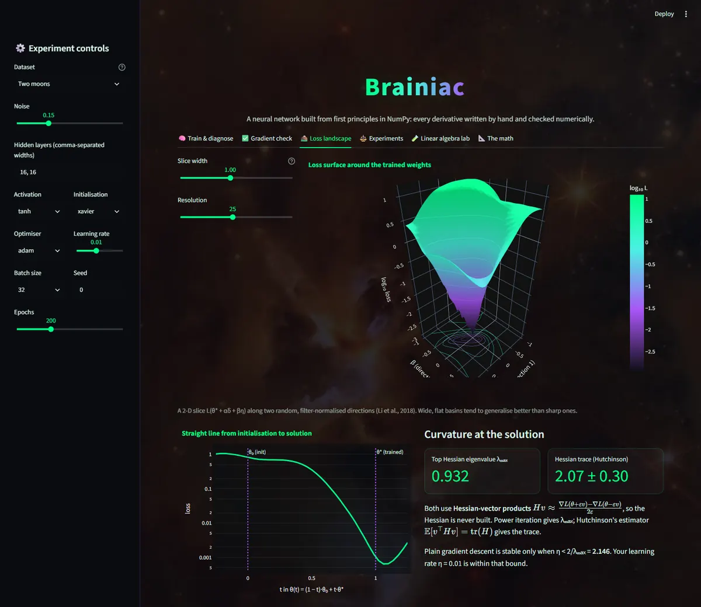
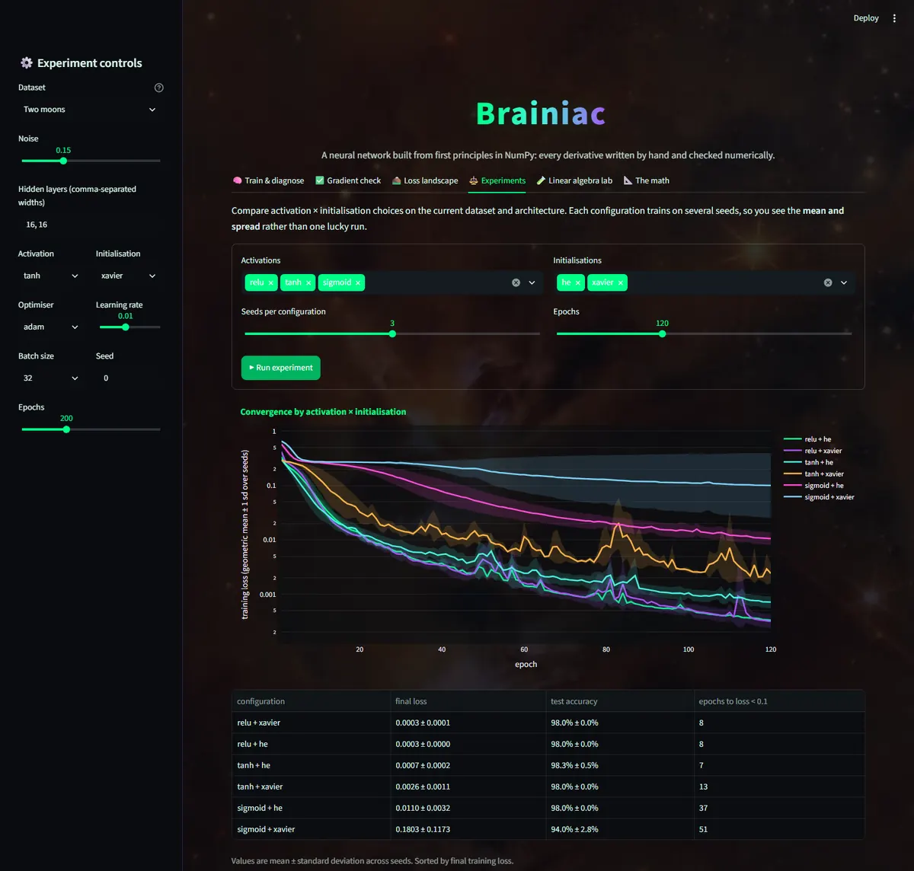
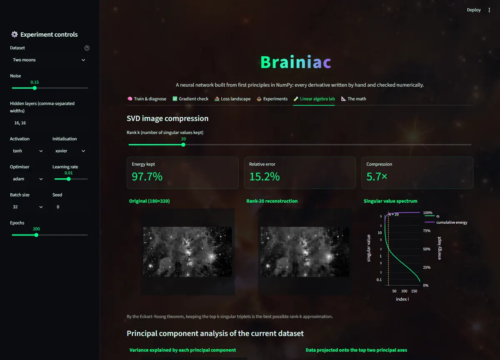

# 🧠 Brainiac: a neural network from first principles

[](https://github.com/manofmanana/brainiac-mathematical-data-analysis/actions/workflows/ci.yml)


**[Live app →](https://brainiac-mathematical.streamlit.app/)**

Brainiac is a feed-forward neural network written from scratch in NumPy. It has no PyTorch, TensorFlow or autograd: every derivative is derived by hand, implemented explicitly, and **verified numerically**. An interactive Streamlit lab lets you train it, check its gradients, look at its loss landscape and Hessian, run controlled experiments, and explore the linear algebra behind it all.

It's a portfolio piece about the mathematics of deep learning: multivariable calculus (backpropagation), linear algebra (SVD, PCA, eigenvalues), and statistics (standardisation, train/test splits, results over multiple seeds).



## What you can do in the app

| Tab | What it shows | The maths |
|---|---|---|
| 🧠 **Train & diagnose** | Decision regions or regression fit, loss and accuracy curves, per-layer gradient norms, weight distributions, test-set accuracy | Chain rule, softmax cross-entropy, SGD / momentum / Adam |
| ✅ **Gradient check** | Backprop vs finite differences for every parameter (relative error ~1e-9) | Central differences, $O(\varepsilon^2)$ truncation error |
| ⛰️ **Loss landscape** | 3-D loss surface around the solution, the path from initialisation, Hessian $\lambda_{\max}$ and trace, the stable step-size bound | Hessian-vector products, power iteration, Hutchinson's estimator, $\eta < 2/\lambda_{\max}$ |
| ⚖️ **Experiments** | Activation × initialisation grid over several seeds: mean ± spread curves and a results table | Variance-preserving initialisation, vanishing gradients |
| 🧪 **Linear algebra lab** | SVD image compression with a rank slider, PCA of the dataset, Fourier low/high-pass filtering | Eckart–Young, covariance eigen-decomposition, 2-D FFT |
| 📐 **The math** | Full derivations of everything above | |

Datasets (all generated locally and seeded, so there are no network calls): two moons, concentric circles, 3-class spirals, Iris, and a noisy sine wave for regression.

<p align="center">
  
  
</p>
<p align="center">
  
  
</p>

## The core maths, briefly

For a batch $X \in \mathbb{R}^{d\times N}$ (one sample per column), each layer computes $Z = WA + b\mathbf{1}^\top$, $A' = f(Z)$. With $G = \partial L/\partial Z$, backpropagation is

$$
\frac{\partial L}{\partial W} = G A^\top,\qquad \frac{\partial L}{\partial b} = G\mathbf{1},\qquad \frac{\partial L}{\partial A} = W^\top G .
$$

For classification the network outputs logits and uses softmax cross-entropy, whose gradient is simply $(P - Y)/N$; it's computed with the log-sum-exp trick so it never overflows. The **📐 The math** tab and [`app/static/math.md`](app/static/math.md) have the full derivations, including activation derivatives, initialisation variance, Adam's bias correction, and why gradient descent needs $\eta < 2/\lambda_{\max}$.

## Verification

The [test suite](tests/) (61 tests) checks the mathematics, not just that the code runs:

- every activation derivative against finite differences (to 1e-6 relative)
- **full-network gradient checks** for every activation × {classification, regression} (relative error < 1e-6)
- initialiser variances match their formulas; softmax cross-entropy is stable for ±1000 logits
- SGD, momentum and Adam all minimise an ill-conditioned quadratic; Adam's first step equals the learning rate (bias correction)
- Hessian-vector products, Hutchinson's trace and power iteration are exact on a quadratic with a known Hessian
- SVD error matches Eckart–Young; PCA eigenvalues match `numpy.cov`; standardisation uses training statistics only
- training reaches > 90% test accuracy on every classification dataset and is bit-for-bit reproducible per seed
- the Streamlit app itself renders every tab and dataset without errors (Streamlit `AppTest`)

```bash
python -m pytest
```

## Run it locally

```bash
git clone https://github.com/manofmanana/brainiac-mathematical-data-analysis.git
cd brainiac-mathematical-data-analysis
python -m venv .venv
source .venv/bin/activate          # Windows: .venv\Scripts\activate
pip install -r requirements-dev.txt
streamlit run main.py
```

The library works on its own too:

```python
from brainiac import NeuralNetwork, load_dataset
from brainiac.gradcheck import gradient_check

data = load_dataset("Two moons")
net = NeuralNetwork([2, 16, 16, 2], activation="tanh", init="xavier", task="classification", seed=0)
print(gradient_check(net, data.X_train, data.Y_train).overall)  # ~1e-10
hist = net.fit(data.X_train, data.Y_train, epochs=200, lr=0.01, optimizer="adam", batch_size=32)
print(net.accuracy(data.X_test, data.Y_test))  # ~0.98
```

A walkthrough notebook with real outputs lives at [`notebooks/brainiac_walkthrough.ipynb`](notebooks/brainiac_walkthrough.ipynb). It's generated by `notebooks/build_notebook.py`, which CI runs on every push so the notebook can't go stale.

## Project structure

```
brainiac/              the library (pure NumPy + SciPy's erf)
  activations.py       ReLU, leaky ReLU, sigmoid, tanh, GELU + exact derivatives
  initializers.py      He, Xavier/Glorot, LeCun, normal, uniform
  layers.py            Dense and Activation layers (explicit forward/backward)
  losses.py            MSE, stable softmax cross-entropy
  optimizers.py        SGD, momentum, Adam
  network.py           NeuralNetwork: mini-batch training, flat-parameter views, diagnostics
  gradcheck.py         finite-difference verification
  curvature.py         Hessian-vector products, Hutchinson trace, power iteration
  landscape.py         filter-normalised loss surfaces, interpolation paths
  experiments.py       multi-seed activation x initialisation comparisons
  linalg_lab.py        SVD compression, PCA, FFT filtering
  datasets.py          seeded datasets with leakage-free standardisation
main.py                Streamlit app
app/                   charts (Plotly), CSS, and the math page
notebooks/             walkthrough notebook + its build script
tests/                 pytest suite
```

## What changed in v2

Version 2 is a ground-up rewrite. Fixes to the original version:

- **GELU derivative:** it was $\Phi(x) + \tfrac12 x\varphi(x)$; the correct form is $\Phi(x) + x\varphi(x)$. The old test that should have caught it only checked the last activation in its loop, with a 0.15 tolerance.
- **Learning rate:** gradients were divided by $N$ twice (in the loss and again in each layer), so the effective learning rate was $\eta/N$.
- **Xavier initialisation:** it was identical to LeCun ($\sqrt{1/n_{\text{in}}}$) instead of $\sqrt{2/(n_{\text{in}}+n_{\text{out}})}$.
- **"3-D loss surface":** it treated the first layer as the whole network. It's now a true slice of the full network's loss.
- **Gradient checker:** it read weights *after* the update and called them the gradient.
- **Iris:** it was fitted as regression on label codes with unscaled features. It's now a proper 3-class classification with a held-out test set.
- **Experiments tab:** it compared a single configuration. It now runs a full grid over several seeds.
- **Dependencies:** removed hard-coded local paths, a background hack that broke Streamlit's popups, and runtime network calls (CoinGecko, seaborn downloads), and cut 60+ pinned packages down to six.

## Author

Alejandro Ines. If you use or adapt this work, please credit the author.
